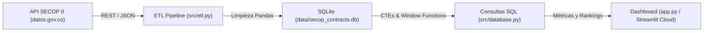

# 🇨🇴 SECOP II Data Pulse: Monitor Analítico de Contratación Pública en Colombia

[](https://secop-data-pulse.streamlit.app)
[](https://github.com/AndresCalCan/secop-data-pulse/actions/workflows/ci.yml)
[](https://www.python.org/)
[](https://www.sqlite.org/)

> **Demo en vivo (sin instalar nada):** 👉 **[https://secop-data-pulse.streamlit.app](https://secop-data-pulse.streamlit.app)**

Pipeline ETL y aplicación analítica en Python que consulta, limpia y analiza contratos públicos del Estado colombiano en tiempo real desde la API abierta del **SECOP II** ([Datos Abiertos Colombia](https://www.datos.gov.co/)).

---

## 📌 Qué resuelve este proyecto
La contratación pública en SECOP II genera miles de registros diarios con montos millonarios y datos crudos difíciles de consultar manualmente. Esta herramienta automatiza el flujo completo desde la extracción hasta la visualización:

1. **Extracción (REST API):** Consulta el endpoint SODA de `datos.gov.co` con filtros dinámicos (`$where`, `$order`, `$limit`).
2. **Transformación (Pandas):** Normaliza textos, convierte fechas, controla valores numéricos inválidos y limpia registros nulos.
3. **Carga y Analítica SQL (SQLite):** Persiste los contratos limpios y ejecuta consultas analíticas con **CTEs (`WITH`)** y **Window Functions (`DENSE_RANK() OVER`)**.
4. **Visualización y Despliegue:** Dashboard interactivo con **Streamlit + Plotly**, desplegado en Streamlit Community Cloud con pruebas unitarias automatizadas en GitHub Actions.

---

## 🏗️ Arquitectura



---

## 📂 Estructura del Repositorio

```text
secop-data-pulse/
├── .github/workflows/
│   └── ci.yml               # Integración continua (pruebas automáticas en cada push)
├── data/
│   └── secop_contracts.db   # Base SQLite precargada para arranque rápido
├── src/
│   ├── etl.py               # Extracción SODA API, limpieza con Pandas y carga a SQLite
│   └── database.py          # Consultas SQL analíticas (KPIs, rankings, agregaciones)
├── tests/
│   └── test_pipeline.py     # Pruebas unitarias de transformación ETL y consultas SQL
├── app.py                   # Aplicación web interactiva en Streamlit
├── run_pipeline.py          # Script CLI para ejecutar el ETL desde consola
└── requirements.txt         # Dependencias del proyecto
```

---

## 🚀 Instalación y Uso Local

### 1. Clonar el repositorio e instalar dependencias
```bash
git clone https://github.com/AndresCalCan/secop-data-pulse.git
cd secop-data-pulse
python -m venv venv
venv\Scripts\activate   # En Linux/macOS: source venv/bin/activate
pip install -r requirements.txt
```

### 2. Ejecutar el pipeline ETL desde consola (CLI)
```bash
python run_pipeline.py --limit 500 --departamento "ANTIOQUIA"
```

### 3. Lanzar el dashboard web
```bash
streamlit run app.py
```

### 4. Correr las pruebas unitarias
```bash
python -m unittest discover -s tests -v
```

---

## 🧠 Ejemplo de Consulta SQL Implementada

Los rankings de contratistas se calculan directamente en el motor SQL con CTEs y funciones de ventana (`DENSE_RANK`):

```sql
WITH ContratistasTotal AS (
    SELECT 
        proveedor_adjudicado,
        documento_proveedor,
        COUNT(*) AS numero_adjudicaciones,
        SUM(valor_del_contrato) AS total_adjudicado_cop
    FROM contracts
    WHERE proveedor_adjudicado IS NOT NULL
    GROUP BY proveedor_adjudicado, documento_proveedor
)
SELECT 
    DENSE_RANK() OVER (ORDER BY total_adjudicado_cop DESC) AS ranking,
    proveedor_adjudicado,
    documento_proveedor,
    numero_adjudicaciones,
    total_adjudicado_cop
FROM ContratistasTotal
ORDER BY total_adjudicado_cop DESC
LIMIT 10;
```

---

## 👨‍💻 Autor
**Andrés Felipe Calderón Cantillo**  
Estudiante de Ingeniería de Sistemas — Universidad Libre (Bogotá, Colombia)  
GitHub: [@AndresCalCan](https://github.com/AndresCalCan)
